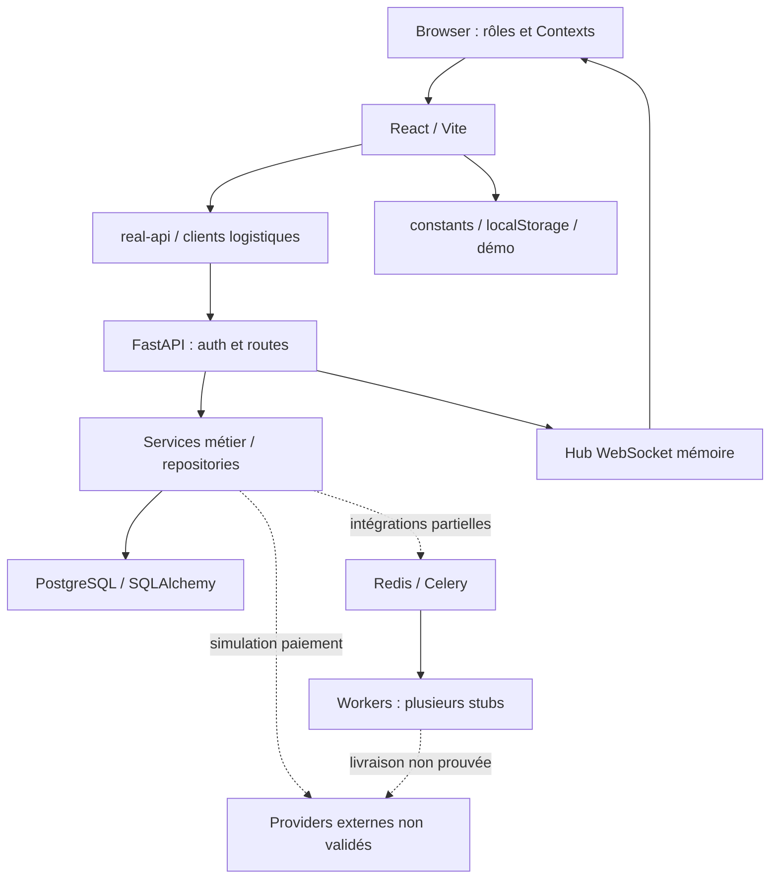

# Architecture réellement présente

Mission : **KOMPRESS-PRR-2026-09** · Collecte : **2026-09-27 UTC** · Recontrôle canonique : **2026-09-28 UTC**

Repository : `KOMFAHQ/Laundry-Express-RDC-2` · Branche : `main` · HEAD audité : `f55e775831e812e77892072c9fcfed16e4ee26fe`.
Les chemins de code cités désignent exclusivement ce HEAD, consultable [sur GitHub](https://github.com/KOMFAHQ/Laundry-Express-RDC-2/blob/f55e775831e812e77892072c9fcfed16e4ee26fe/).
Les preuves locales, leur portée et leurs limites sont indexées dans [EVIDENCE-INDEX.md](EVIDENCE-INDEX.md).

Le dépôt contient un frontend racine et un monolithe API modulaire, avec un second univers métier historique dans le navigateur. La présence de dossiers `apps/web` ne signifie pas qu’un second frontend production opérationnel existe.

| Couche | Réalité source | Validation / limite |
|---|---|---|
| UI | React19, TypeScript5.8, Vite8 ; Contexts Auth/Data/Order/Navigation, App.tsx sélectionne les pages | build +393 tests locaux ; navigateur connecté non exécuté |
| Routing | NavigationContext / currentPage et switch ; react-router-dom déclaré mais ne démontre pas un routage URL complet | deep-links/reload/back et permissions à prouver dans browser |
| API clients | services/real-api.ts ~4080 lignes, bearer/refresh, timeout ; services/logistics-api.ts ; payment-flow.ts | contrats en partie mappés, plusieurs branches mock/fallback |
| Rôles | customer, partner owner/staff, admin/super-admin, manager, driver ; UI mobile dédiée | visibilité navigation ≠ autorisation serveur |
| API | FastAPI0.104.1 ; routes/services/repositories/schemas ;521 routes importées en mode production | import local ; grande surface, aucune certification exhaustive endpoint |
| Auth | JWT accès, refresh hashé, user actif, rôles dépendances/manuels | bonnes primitives ; reset et périmètres objet défaillants |
| DB | PostgreSQL16, SQLAlchemy2.0.23, sessions sync+async ;183 tables metadata | mappers importés ; pas de validation online de183 tables |
| Migrations | Alembic1.12.1,61 révisions, un head | graphe cohérent mais baseline incomplète |
| Redis/Celery | Redis7, Celery5.3.4 ; broker/result, worker | aucune exécution worker/queue ; hub WS séparé et non distribué |
| Intégrations | SMTP Mailpit, AI Gemini client, provider enums/config, seeds email/SMS/WhatsApp | config/modèles ne constituent pas intégration fournisseur validée |
| Admin | nombreuses routes de configuration et dashboards | persistance partielle, seeds synthétiques, certains gestes locaux |

## Environnements à ne pas confondre

| Environnement | Configuration / instance | Statut |
|---|---|---|
| DEV | compose avec reload, Vite et bind mounts ; valeurs exemples | IMPLEMENTED ; bootstrap BROKEN |
| LOCAL TEST | checkout exact SHA, Node24.19/Python3.12, dépendances installées ; pas de PG/Redis/Docker | VALIDATED_LOCAL uniquement pour checks recensés |
| CI | Node22/Python3.12 ; static-gate réellement exécuté | VALIDATED_CI statique ; runtime non validé |
| STAGING | templates/harness/scripts ; aucune cible vérifiée | UNKNOWN runtime ; NO_STAGING_FOUND dans sources accessibles |
| PRODUCTION | aucun déploiement relié au code et au SHA | UNKNOWN |

Aucune chaîne de production complète frontend statique→reverse proxy TLS→API privée→DB privée n’est configurée et démontrée. L’exemple nginx WebSocket est un fragment de configuration, pas un déploiement. Le monolithe demeure une base plausible pour un petit pilote **après** G1–G6, sans extraire de services.
