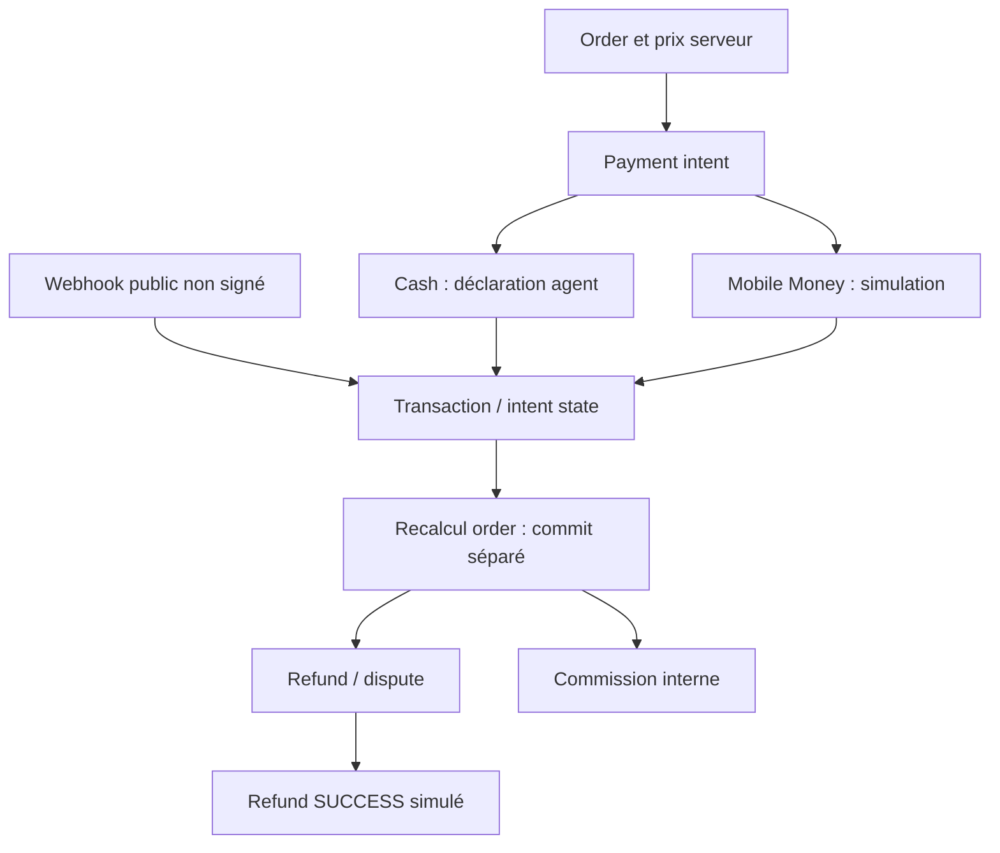

# Payments truth

Mission : **KOMPRESS-PRR-2026-09** · Collecte : **2026-09-27 UTC** · Recontrôle canonique : **2026-09-28 UTC**

Repository : `KOMFAHQ/Laundry-Express-RDC-2` · Branche : `main` · HEAD audité : `f55e775831e812e77892072c9fcfed16e4ee26fe`.
Les chemins de code cités désignent exclusivement ce HEAD, consultable [sur GitHub](https://github.com/KOMFAHQ/Laundry-Express-RDC-2/blob/f55e775831e812e77892072c9fcfed16e4ee26fe/).
Les preuves locales, leur portée et leurs limites sont indexées dans [EVIDENCE-INDEX.md](EVIDENCE-INDEX.md).

## Nature réelle de chaque moyen

| Moyen/surface | Réalité | Statut |
|---|---|---|
| Intent | DB intent lié order/customer, validation montant total et garde commande déjà payée | IMPLEMENTED / tests unité partiels |
| Cash | confirmation déclarative par rôle ; transaction SUCCESS ; recalcul order après commit | PARTIAL ; ni affectation ni caisse réelle validées |
| Mobile Money | initiate appelle _simulate_mobile_money_payment sans garde serveur ; référence SIM_ | IMPLEMENTED simulation ; BROKEN comme paiement réel |
| Sandbox fournisseur | aucune requête/réponse externe sandbox démontrée | CLAIMED / UNPROVEN |
| Providers M-Pesa/Airtel/Orange/autres | enums, variables, metadata/dashboard | IMPLEMENTED config ≠ intégration provider-backed |
| Callback | route publique, transitions selon chaîne event_type, pas de signature | BROKEN |
| Refund | approval persistée puis SUCCESS simulé | IMPLEMENTED simulation ; aucun remboursement externe |
| Dispute | dossier/statuts/commentaires/résolution internes | PARTIAL ; autorité de remboursement à contrôler |
| Commission | compute/settle internes ; Float et états | PARTIAL ; « settled » ne prouve pas un virement |
| UI live | étiquette pilotConfig depuis VITE_PAYMENT_MODE | CLAIMED / UNPROVEN ; ne change pas provider serveur |

## Intégrité et autorisation

`create_payment_intent` contrôle propriétaire et rapproche montant attendu du total ; ne pas reprendre l’affirmation historique « aucun contrôle montant ». Mais il prend `data.currency` sans lier la devise à celle de la commande. `payment-flow.ts` utilise USD par défaut, alors que plusieurs défauts backend sont CDF. Même nombre ne signifie pas même valeur.

`initiate_payment` ne reçoit pas current_user ; `confirm_cash_payment` ne reçoit pas l’identité de l’agent affecté, malgré son docstring. Ce défaut s’ajoute à l’absence de garde de répétition terminale sur cash. Cash réécrit amount_paid puis crée une nouvelle transaction à chaque confirmation admissible. Paiement, recalcul ordre, promotion/loyalty et événements ne sont pas un seul commit indivisible.

Callback : `get_transaction_by_provider_id` recherche globalement ; pas de contrôle que transaction existante corresponde à intent/provider demandé. Un événement contenant « succeeded » ou « completed » marque payé sans contrôler la valeur reçue. La branche nouvelle transaction ne renseigne pas montant/devise depuis le fournisseur : les defaults ORM sont0/CDF. Cela ne vérifie aucun mouvement réel ; aucun succès universel de payload forgé n’est revendiqué. Le modèle PaymentProviderEvent existe mais n’est pas utilisé comme déduplication par ce handler.

Refund : vérifie montant individuel contre première intention réussie ; pas de budget cumulé verrouillé ni preuve de concurrence. Commission : check-then-insert sans contrainte unique par order, Float monétaire ; force_recompute peut remettre l’état en computed. Aucun ledger financier immuable avec rapprochement externe n’est validé.

## Option pilote et future frontière KomfaPay

Le pilote peut viser **cash supervisé uniquement**, après B03–B09 et une procédure réelle de reçu, collecte, clôture, écart et remboursement. Désactiver simulation et routes inutiles côté serveur est nécessaire ; masquer un moyen dans l’UI ne suffit pas. Une opération cash validée prouvera du cash, pas Mobile Money.

KomfaPay pourrait posséder orchestration provider, identité transaction externe, signature/deduplication webhook, ledger et refund fournisseur. KomfaPress doit garder prix/catalogue/order et décision métier de remboursement. Actuellement PaymentService touche directement order, loyalty, referral, promotion, commissions et DB commune : extraction coûteuse et risquée avant stabilisation. D’abord contrats internes, idempotence, transitions et preuves ; ensuite un adaptateur KomfaPay uniquement si ses garanties et son exploitation réelles sont vérifiées. Aucune migration effectuée.
