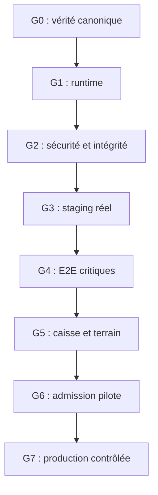

# Roadmap exécutable par gates

Mission : **KOMPRESS-PRR-2026-09** · Collecte : **2026-09-27 UTC** · Recontrôle canonique : **2026-09-28 UTC**

Repository : `KOMFAHQ/Laundry-Express-RDC-2` · Branche : `main` · HEAD audité : `f55e775831e812e77892072c9fcfed16e4ee26fe`.
Les chemins de code cités désignent exclusivement ce HEAD, consultable [sur GitHub](https://github.com/KOMFAHQ/Laundry-Express-RDC-2/blob/f55e775831e812e77892072c9fcfed16e4ee26fe/).
Les preuves locales, leur portée et leurs limites sont indexées dans [EVIDENCE-INDEX.md](EVIDENCE-INDEX.md).

La mission autorise **l’audit et ses documents**. Les tâches correctives ci-dessous attendent une autorisation humaine distincte. Ordre par dépendance ; aucun délai/calendrier inventé. Un gate ne passe qu’avec sa preuve, et pas parce qu’un ticket/commit existe.

Les tests locaux ciblés commencent dès G1/G2 ; G4 exige en plus la preuve complète sur le vrai staging. Les sauvegardes/contraintes de données se traitent avant toute migration héritée, pas après un déploiement.

## G0 — Canonical Truth

| Champ | Exécution attendue |
|---|---|
| Objective | Fixer source et limites de preuve. |
| Tasks | Vérifier repo/HEAD/PR/CI/protections/environnements ; inventaires ; classer docs et preuves. |
| Evidence required | HEAD/tree, captures API, logs, matrices, blockers et limites de couverture. |
| Exit criteria | Audit documentaire livré sur branche séparée ; SHA audité constant ; aucune validation distante inventée. |
| Blockers / dépendances | Pas de blocker à la livraison de ce dossier ; accès infra/secrets reste UNKNOWN, pas un faux succès. |
| Rollback considerations | Aucune mutation applicative ; dossier versionné indépendamment ; main conservée. |
| État actuel | Réalisé pour périmètre accessible. Recommencer preflight si code bouge. |
| Owner à nommer | Responsable audit / propriétaire repository |

## G1 — Runtime Reproducibility

| Champ | Exécution attendue |
|---|---|
| Objective | Démarrer le système exact depuis une machine et DB vierges. |
| Tasks | Autorisation corrective requise ; réparer URI/dépendances puis baseline ; figer lock/images ; produire runtime isolé sans reload ; migrer via job unique ; aligner ports/test env. |
| Evidence required | Logs build images/digests ; versions ; upgrade online PostgreSQL16 ; relecture schéma ; web/API/worker selon scope ; commandes répétables. |
| Exit criteria | Deux constructions/démarrages propres passent ; DB→head sans schema caché ; /health et readiness distinctes ; pas de seed démo automatique. |
| Blockers / dépendances | B01,B02,B10 ; B12 environnement tests. |
| Rollback considerations | Volumes jetables uniquement pour bootstrap ; aucun downgrade destructif sur DB réelle ; conserver ancienne image et copies. |
| État actuel | NON PASSÉ. Précondition à toute preuve E2E de stack. |
| Owner à nommer | Backend / infra |

## G2 — Security & Data Integrity

| Champ | Exécution attendue |
|---|---|
| Objective | Fermer chemins de fuite et mutations financières non sûres. |
| Tasks | Retirer reset token ; sécuriser callbacks ou désactiver moyens hors scope ; ownership/tenant REST/WS ; idempotence/atomicité/devises/refund/commissions ; anti-abus ; secrets/logs/deps ; répétition migration héritée. |
| Evidence required | Tests négatifs deux tenants et tous rôles ; état DB inchangé après rejet ; tests concurrence/replay/crash ; scan dépendances trié ; restore représentatif ; bundle/logs sans secret. |
| Exit criteria | 0 P0 ouvert ; tous risques P1 sécurité/donnée requis par scope fermés ; aucun statut simulated/live ambigu ; donnée représentative migre et se restaure. |
| Blockers / dépendances | B03–B09,B16,B19,B20 ; dépend G1. |
| Rollback considerations | Révoquer tokens si exposition avérée ; snapshot avant migration ; replay financier interdit sans rapprochement ; désactivation ciblée et restore planifié. |
| État actuel | NON PASSÉ. Pas de publication Internet du runtime vulnérable. |
| Owner à nommer | Backend sécurité / data / exploitant |

## G3 — Real Staging

| Champ | Exécution attendue |
|---|---|
| Objective | Installer une cible séparée identifiable et observable. |
| Tasks | Provisionner domaine/TLS/hôte privé DB/Redis ; secrets dédiés ; déploiement SHA/digests ; config expurgée ; backups ; readiness/alertes ; périmètre UI/API pilote sans démo. |
| Evidence required | GitHub environment/deployment ou registre équivalent ; DNS/TLS ; versions browser/API ; migration head ; smoke non destructif ; journal restore/alerte. |
| Exit criteria | STAGING_EXISTS_AND_VERIFIED avec SHA attribué ; aucune donnée réelle non autorisée ; perte DB détectée ; restore démontré. |
| Blockers / dépendances | B10,B13–B16,B21 ; dépend G1/G2. |
| Rollback considerations | Retour image précédente si compatible ; maintenance ; restore DB testé ; pas de partage DB production. |
| État actuel | NON PASSÉ ; aucune cible trouvée. |
| Owner à nommer | Infra / responsable staging |

## G4 — Critical E2E

| Champ | Exécution attendue |
|---|---|
| Objective | Démontrer corridors critiques sur le SHA destiné au pilote. |
| Tasks | Exécuter build/Vitest/pytest requis ; résoudre FAIL/ERROR sans masquer ; truth dispatch exact SHA ; web/browser et rôle/tenant tests ; auth→order→cash→task→proof→refund/commission ; erreurs/retries. |
| Evidence required | Run ID/SHA/jobs/services ; logs et artefacts expurgés ; assertions DB ; vidéo/captures browser si utiles ; liste skips et justification hors scope. |
| Exit criteria | Aucun skip ni failure du périmètre critique ; browser réel sans mocks ; invariants et reprise démontrés ; CI bloquante au bon SHA. |
| Blockers / dépendances | B11,B12,B13 ; exige G3 pour validation staging et G1/G2 pour exécution sûre. |
| Rollback considerations | Tests dans namespace/DB isolés ; garder dataset de preuve ; pas de suppression globale ; échec empêche promotion. |
| État actuel | NON PASSÉ ; seul static-gate validé en CI. |
| Owner à nommer | QA / développeurs des corridors |

## G5 — Payment/Logistics External Reality

| Champ | Exécution attendue |
|---|---|
| Objective | Relier états logiciels aux mouvements financiers et événements terrain. |
| Tasks | Choisir cash supervisé ou provider réellement vérifié ; intégrer sandbox seulement si requis ; tester reçus/clôture/remboursement ; pressing+driver téléphones réels, GPS/incident/réseau ; vérifier canal de communication utile. |
| Evidence required | Référence fournisseur si méthode activée ; rapprochement caisse ; preuve pickup/delivery ; mission sans admin réparateur ; responsables signent écarts et traitements. |
| Exit criteria | Aucun paid/refunded sans mouvement attesté ; aucune completion sans preuve ; erreurs et litiges maîtrisés ; pas d’obligation d’extraction Komfa. |
| Blockers / dépendances | B05,B09,B17,B18,B21 ; dépend G2/G4. |
| Rollback considerations | Suspendre collecte/nouvelles missions ; rapprocher externe avant retry ; remboursement via procédure autorisée ; préserver preuves. |
| État actuel | NON PASSÉ ; fournisseurs et terrain UNKNOWN. |
| Owner à nommer | Responsables pressing / logistique / caisse |

## G6 — Pilot Readiness

| Champ | Exécution attendue |
|---|---|
| Objective | Autoriser un périmètre réel réduit avec capacité de contrôle quotidien. |
| Tasks | Nommer opérateurs/support/on-call ; fixer zone/partenaire/horaires/capacité et moyens acceptés ; former ; privacy/rétention ; tableau KPI réel ; stop conditions ; exercice incident/restore ; décision humaine go/no-go. |
| Evidence required | Dossier G1–G5 complet ; tickets blockers fermés ; runbook ; formation/rehearsal ; seuils/volumes choisis par exploitant ; rapprochement quotidien. |
| Exit criteria | 0 P0 et0 P1 requis par scope ouverts ; exclusion formelle des modules hors pilote ; ressources support disponibles ; go humain enregistré. |
| Blockers / dépendances | B01–B21 selon scope et règles de sécurité ; aucune dérogation à fuite de données/financière. |
| Rollback considerations | Arrêt nouvelles commandes, parcours existants traités manuellement sous contrôle ; information opérateurs ; conservation preuves et caisse. |
| État actuel | NON PASSÉ. NOT READY. |
| Owner à nommer | Owner produit / responsable opérationnel |

## G7 — Controlled Production

| Champ | Exécution attendue |
|---|---|
| Objective | Promouvoir progressivement un artefact traçable après résultats réels du pilote. |
| Tasks | Versions/releases/digests ; protections GitHub ; séparer accès prod ; sécurité/charge selon volume ; monitoring/SLO ; backup/restore ; canary ou cohorte ; vérification SHA sur instance ; rollback répété. |
| Evidence required | Déploiement et versions frontend/API/DB reliés à commit ; corridors production autorisés ; métriques terrain ; alerte/restore ; release et décision de promotion. |
| Exit criteria | PRODUCTION_SHA connu ; configuration et corridors réels vérifiés ; rollback sûr ; ownership et suivi quotidien établis. |
| Blockers / dépendances | G6 non passé ; B22/B23 hardening selon risque ; B24 governance avant promotion contrôlée. |
| Rollback considerations | Rollback image seulement si schéma compatible ; autrement maintenance + restore/version-forward planifiés ; mouvements financiers rapprochés séparément. |
| État actuel | NON PASSÉ ; production UNKNOWN. |
| Owner à nommer | Responsable release / infra / opérations |

## Première intervention proposée à décision humaine

Autoriser une PR corrective G1 strictement limitée au bootstrap (B01/B02), avec stratégie explicitement distincte DB vierge/DB héritée et preuve Docker PostgreSQL jetable. Puis G2, sans déployer la version vulnérable sur Internet. Ne pas financer une extraction KomfaPay/Express/Engage comme substitut à ces preuves. Le présent dossier ne vaut pas approbation de cette correction.
